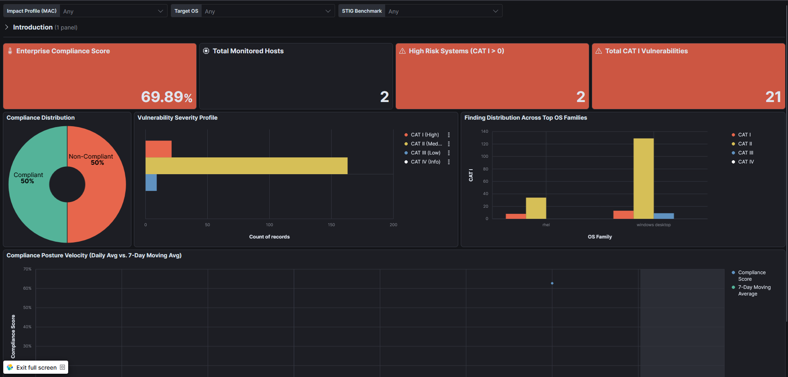
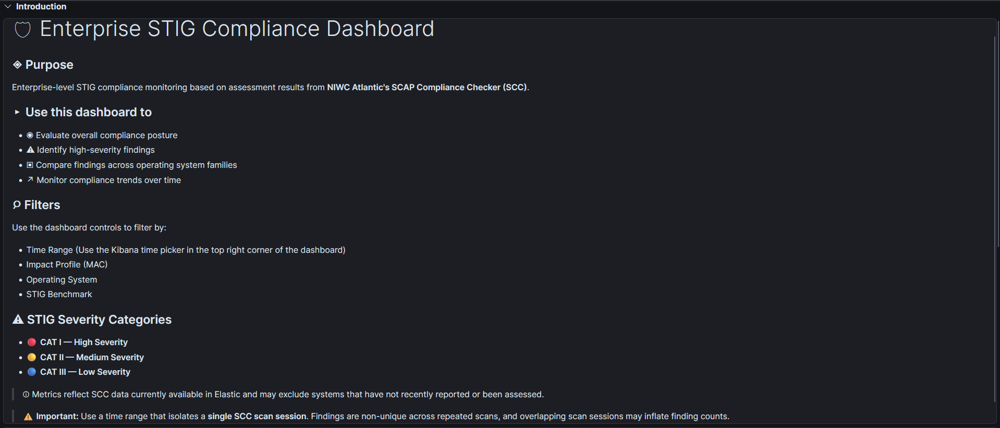

# Elastic Stack - Enterprise STIG Compliance Dashboard

**Version:** 1.0  
**Platform:** Elastic Stack 8.19.x +  
**Data source:** NIWC Atlantic SCAP Compliance Checker (SCC) assessment data  
**Author:** Ryan Clark  
**Contact:** cyberdood@protonmail.com

## Overview

The **Enterprise STIG Compliance Dashboard** provides a centralized view of enterprise security compliance based on assessment results from NIWC Atlantic's SCAP Compliance Checker (SCC). It presents overall compliance posture, monitored systems, high-risk assets, findings by severity and operating system, and compliance trends over time. Interactive filters enable targeted analysis by operating system, STIG benchmark, impact profile, and assessment timeframe.

The dashboard is designed around SCC **scan summary** records (`stig.document_type: "scan_summary"`). Summary records contain pre-calculated results and aggregate counts, allowing the dashboard to avoid recalculating metrics from individual rule-result events. This generally reduces query workload, especially in environments with hundreds or thousands of monitored systems.

> **Important — scan selection:** Set the dashboard time range to isolate a **single SCC assessment cycle or scan session** whenever possible. Findings and summary records can recur in later scans. Including multiple scans of the same asset may inflate counts or weight repeatedly scanned systems more heavily. A time window alone does not guarantee one assessment per host; verify the scan coverage when interpreting enterprise metrics.

## Dashboard interface and navigation

### Dashboard overview

*Figure 1 — Main dashboard view. The three filter controls are located across the top, directly above the collapsed **Introduction** section and the compliance metrics.*

The dashboard opens with the **Introduction** section **collapsed by default**, keeping the key compliance metrics and visualizations in view. From top to bottom, the dashboard presents the filter bar, a collapsible help section, four headline metrics, compliance and finding-distribution charts, and a historical compliance trend.

### Filtering the dashboard

Use the three **dropdown controls at the top of the dashboard** to narrow the assessment data. They work with the dashboard's global time range, which is set using Kibana's time picker.

| Control | Purpose | Example use |
| --- | --- | --- |
| **Impact Profile (MAC)** | Filter SCC results by the selected STIG impact/mission assurance profile. | Focus on assessments using `MAC-1_Classified`. |
| **Target OS** | Limit results to a selected target operating system. | Pinpoint an operating system or compare the compliance posture between operating systems. |
| **STIG Benchmark** | Filter to a specific STIG benchmark. | Focus on a specific STIG benchmark (i.e. `RHEL_9_STIG`) rather than mixing assessments from different benchmarks. |

The controls default to **Any**, meaning no restriction is applied for that field. Select a value to narrow the metrics and charts to matching assessment summaries; clear the selection to return to the broader view. Controls can be combined to focus on a more specific population. If no results appear after filtering, confirm that the chosen combination exists within the selected time range.

**Important:** Choose a time range covering the intended SCC scan cycle. The dropdown controls restrict the matching events, but do not deduplicate repeated scans of the same system.

### Collapsible Introduction panel

*Figure 2 — The **Introduction** section expanded. This panel provides dashboard purpose, usage guidance, filter descriptions, severity category definitions, and important data interpretation notes.*

To access the built-in guidance, click the **chevron next to Introduction** just below the filter controls. The section expands to reveal the Markdown information panel. Click the chevron again to collapse it and restore more space to the visualizations.

The introduction explains the dashboard's intended use, identifies the available filtering controls, lists CAT I–III severity categories, and reminds users that findings may repeat across scan sessions. It also clarifies that dashboard counts reflect SCC assessment data available in Elastic, which might not include every system in the organization's inventory.

The Introduction is **informational**, not a filter: expanding or collapsing it does not change the underlying data or calculations.

## Dashboard Import
Choose **one** of the following export files:

| File | Intended use |
| --- | --- |
| `Enterprise_STIG_Dashboard_with_dataview_X.X.ndjson` | Recommended when using the default SCC/Elastic index or data-stream naming convention and you want to import the dashboard along with its packaged data view. |
| `Enterprise_STIG_Dashboard_without_dataview_X.X.ndjson` | Recommended when an existing/custom data view is used, such as deployments with a custom SCC index naming convention. You must link the dashboard's saved-object references to the appropriate data view. |

**Expected source data:** SCC records with `stig.document_type`, `host.name`, `host.os.*`, `stig.benchmark.*`, and `stig.summary.*` fields. The default data stream in the example deployment uses `logs-stig_scap_compliance-*` (backing indices resemble `.ds-logs-stig_scap_compliance-default-*`). Your deployment may use another name.

## Option A — Import with the included data view

Use this if the deployment uses the default SCC data-stream/index naming convention expected by the included data view.

1. Sign in to Kibana and select the intended **Space**.
2. Navigate to **Stack Management → Saved Objects**. You need Saved Objects Management and appropriate Dashboard permissions.
3. Click **Import** and select `Enterprise_STIG_Dashboard_with_dataview_X.X.ndjson`.
4. Review the import options and click **Import**. If Kibana detects an existing object with the same identity, review the conflict carefully before overwriting anything.
5. Open the dashboard using the instructions in **Viewing and using the dashboard** below.

If the packaged data view points at a non-existent index, update its index pattern where appropriate or use Option B with a locally created data view instead.

## Option B — Import without a data view (custom index naming)

Use this if SCC events are ingested into a custom index, alias, or data stream, or if your environment already has a compatible data view. This typically applies when the default index naming convention has been modified in SCC under Options → SIEM Options → Elastic Options → Elastic Index.

1. Verify that SCC events are indexed and that `stig.document_type: "scan_summary"` exists.
2. In **Stack Management → Data Views**, create or select a data view for the local SCC data. Set its index pattern to **your actual index/alias/data-stream name**, and select `@timestamp` as the time field.
3. Check that the data view exposes the required `stig.summary.*` numeric fields, `host.name`, `host.os.*`, `stig.benchmark.*`, and `stig.document_type`.
4. Navigate to **Stack Management → Saved Objects → Import** and select `Enterprise_STIG_Dashboard_without_dataview_X.X.ndjson`.
5. If Kibana reports a **missing data view / missing reference**, use the import resolution UI to associate the reference with your existing SCC data view, if that option is offered. If the UI does not offer a suitable replacement, resolve the references through the supported Saved Objects import-resolution process; do not assume matching data-view titles alone will automatically fix saved-object IDs.
6. Once imported, open the dashboard and check every panel and control. If a panel cannot find the correct fields or data view, edit that visualization and select the local SCC data view.
7. Save any corrected visualizations and dashboard configuration.

> **Important:** This export option does not make the dashboard independent of a data view. It simply omits the packaged one. The locally defined data view still must satisfy the dashboard's referenced field names and field types. This import process is generally expected to work if the only thing chnaged was the "Elastic Index" naming convention in SCC. There is no expectation that this import process will work with an index pattern or data unrelated to SCC.

## Viewing and using the dashboard

1. In Kibana, go to **Analytics → Dashboard** (or search for *Dashboard* from Kibana's global search).
2. Open **Enterprise STIG Compliance Dashboard**.
3. Set the global time picker to encompass the SCC assessment cycle you want to review, ideally without including repeated scans of the same hosts.
4. Use the **Impact Profile (MAC)**, **Target OS**, and **STIG Benchmark** dropdowns at the top to narrow the data; leave any dropdown set to **Any** to avoid filtering on that dimension.
5. Expand **Introduction** using its chevron if you need definitions or usage guidance; it starts collapsed by default. Then review the compliance score, monitored-host count, CAT I high-risk host count, findings-by-severity distribution, findings-by-OS distribution, and compliance trend panels.
6. Click applicable chart categories or use Kibana filters to investigate a subset of assets. Clear filters to return to the broader assessment.

### How the metrics are interpreted

The dashboard's summary-based panels use SCC `scan_summary` data, rather than counting every rule-result document. The intended computations are:

| Panel or measure | Summary-based interpretation |
| --- | --- |
| Enterprise Compliance Score | `SUM(stig.summary.rules_passed) / (SUM(stig.summary.rules_passed) + SUM(stig.summary.rules_failed))`, formatted as a percentage. This is a **rule-weighted pass rate**, not an average of host scores. |
| Total Monitored Hosts | Unique count of `host.name` in matching summary records. |
| High Risk Systems (CAT I > 0) | Unique count of `host.name` where `stig.summary.cat1_fails > 0`. |
| Total CAT I Findings | Sum of `stig.summary.cat1_fails`. |
| Compliance Distribution | Hosts/assessments classified using `stig.summary.compliance_rate` and the configured compliance threshold (for example, 90%). |
| Severity Profile | Sums of `stig.summary.cat1_fails`, `cat2_fails`, `cat3_fails`, and `cat4_fails`. |
| Findings by Operating System | The same CAT-level summary counts grouped by `host.os.name` or the configured OS field. |
| Compliance Trend | Daily average of summary compliance rates and, where configured, a seven-day moving average. |

These are the intended summary-based calculations discussed for this dashboard; the actual saved Lens configurations should be checked after import. **Multiple summaries per host/benchmark** within the time window can change the meaning of totals and averages.

### Compliance categories

- 🔴 **CAT I — High severity**
- 🟡 **CAT II — Medium severity**
- 🔵 **CAT III — Low severity**
- ⚪ **CAT IV — Informational**, where present in SCC output

The dashboard can use an operational 90% compliance target, but this is a **locally configured reporting threshold**, not a universal DISA pass/fail definition.

## Compatibility and references

The dashboard was developed using **Kibana 8.19.x** as a baseline and will work with newer versions. Saved-object exports should be imported into a compatible version (8.19.x or newer). Kibana supports migrations toward compatible newer releases, but exported saved objects cannot necessarily be imported into older versions.

- [Elastic: Manage saved objects (8.19)](https://www.elastic.co/guide/en/kibana/8.19/managing-saved-objects.html)
- [Elastic: Import saved objects API (v8)](https://www.elastic.co/docs/api/doc/kibana/v8/operation/operation-importsavedobjectsdefault)
- [Elastic: Lens (8.19)](https://www.elastic.co/guide/en/kibana/8.19/lens.html)

---

**Release:** Enterprise STIG Compliance Dashboard 1.0  
**Data scope:** NIWC Atlantic SCC-generated assessment summaries
