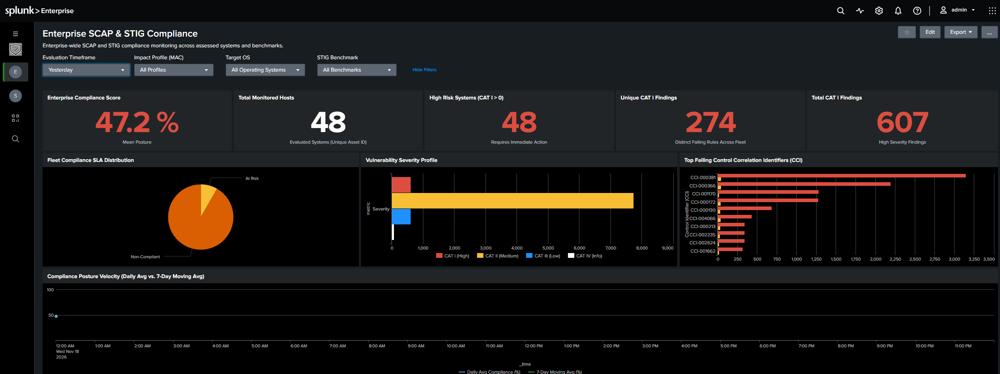
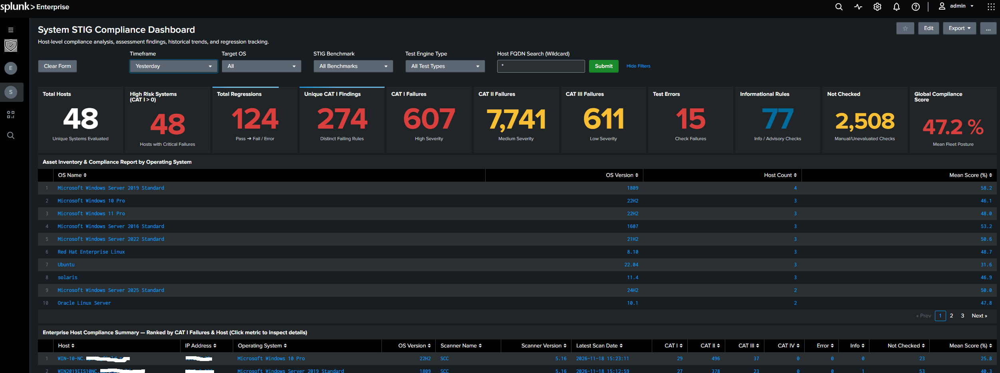

# SCAP & STIG Compliance — Splunk Dashboard v0.2.2

This directory contains source, installable `.spl`, documentation, and validation fixtures for example SCAP/STIG compliance dashboards.   All dashboards are examples only, and users are recommended to modify, improve and contribute their updates back to the community.

- `src/scap_stig_compliance/` — installable app source
- `build/scap_stig_compliance-0.2.2.spl` — compiled Splunk application (tar.gz)
- `docs/` — producer-neutral dashboard guide, DOCX/PDF
- `INSTALL.md` — macro override and ingestion instructions
- `CHANGELOG-0.2.2.md` — change log and remaining limitations
- `tests/` — static contract regression tests and synthetic example data

